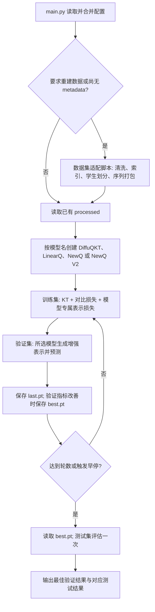

# DiffuQKT / LinearQ / NewQ / NewQ V2 / DHA-KT：模型流程与逐文件说明

更新时间：2026-10-19。本文中的路径均相对于项目根目录 `F:/Postgraduate/DeepLearning/GIAKT`。

## 1. 恢复后的模型与运行范围

当前支持 `src.model.DiffuQKT`、`src.model.LinearQ`、`src.model.NewQ`、`src.model.NewQV2` 和 `src.model.DHAKT`，默认选择 DiffuQKT。前两者共用的原始题目表示为：

```text
C = concept[skill]                 # 知识点向量，维度 d
D = sigmoid(difficulty[problem])    # 每道题一个可学习难度标量
V = variation[skill]               # 知识点变化向量，维度 d
Q = C + D * V                     # 每次题目交互的向量，维度 d
```

`concept`、`difficulty`、`variation` 和答案嵌入均随机初始化并参与梯度更新；padding 索引为 0，相应嵌入行与梯度保持为 0。ASSIST09 的多知识点交互分别对有效知识点的 C、V 取均值，再使用同一道题的 D；不会把一次作答复制成多个预测目标。

DiffuQKT 完整包含条件扩散、AKT 遗忘注意力知识检索、原始/增强表示的对比学习和答题正确性预测。去噪器接收知识点向量、带噪题目向量、一个难度标量和时间步嵌入，输入宽度为 `3*d+1`。默认训练目标为：

```text
loss = kt_loss + 0.001 * contrastive_loss + 0.01 * diffusion_loss
```

训练时随机选择扩散时间步，预测未加噪的题目表示并计算 MSE；评估时从噪声开始完整反向采样。评估不计算训练辅助目标，两个辅助损失输出 `null`，并标记 `loss_mode: prediction_only`。

LinearQ 用可学习题目向量 E_q 经两组独立线性映射产生 A、B，构造 `Q*=(C+A)+D*(V+B)`；Q 与 Q* 进入和 DiffuQKT 完全相同的知识检索、状态对比与预测实现。LinearQ 的目标为 `KT + contrastive_weight*LC + diffusion_weight*L_item`，L_item 对训练题目去重等权并除以嵌入维度，不构造扩散网络。diffusion_loss 字段记录 L_item，保留当前配置权重 0.03。训练入口用 `--model linearq` 选择；详细公式、初始化与运行规则见 [linearq.md](linearq.md)。

NewQ 用题目条件的双线性打分，将当前观测概念集合中的 C、V 按同一组权重融合，构造 `Q=C_bar+D*V_bar+R_q`。R_q 由默认 16 维题目向量线性投影得到，概念条件改为同维的 C_bar+R_q；扩散、知识检索、对比与预测全部继承 DiffuQKT，损失仍为原有三项。总参数硬上限为同配置基线的 4 倍。详细设计与核验见 [newq.md](newq.md)。

NewQ V2 用独立的 8 维注意力代码与 8 维残差代码，按 gamma=2、tau=1 的余弦匹配融合 C/V。两个路由字段决定 off/condition/target/both；off/condition 生成语义后融合 R，target/both 生成完整 Q 后直接使用。residual_condition_detach 默认 false，可只断开独立 R 条件梯度。residual_fusion 默认 add，可改 concat；residual_concat_keep_2d=true/1 保留 2d 并适配本模型后续宽度，false/0 用共享可学习线性层回到 d。原始与增强分支融合规则一致。当前 YAML 保留用户的 enabled=false 设置。详见 [newq_v2.md](newq_v2.md)。

本次已移除训练集 IRT-2PL 拟合、学生能力估计、Q–KC 二部图训练结构、GCN 编码/预训练、IRT 统计参数初始化与有界微调、双方向 Vb/Va，以及依赖这些结构的题目行为扩散分支。运行入口不再提供这些架构的选择开关。

当前训练路径依赖根目录入口、公共/模型专属/数据集配置、数据处理脚本、`src/data`、`src/model`、`src/training` 和 `src/utils`。原始数据、原版模型的历史实验、作者源码快照和个人工具设置保留在各自位置，以下分别列明。参考快照不会被运行入口导入。

## 2. 从数据到训练结果的流程



验证 AUC 用于选模；验证集只有一个标签类别、AUC 无法定义时，改用验证 BCE。每轮都进行验证，最终测试使用最佳轮次参数。checkpoint 保存模型名称、模型参数、Adam 状态、构造参数、配置、轮次、验证结果和数据元信息 SHA256。评估按 checkpoint 恢复模型类型；没有模型名称的历史权重按 DiffuQKT 处理。评估不需要保存参数梯度。

当前公共配置 preprocess_each_run=false，训练启动时复用已有产物；设为 true、指定 --preprocess 或缺少 metadata.json 时重建数据。同一次训练各轮共用该划分。单独评估不触发预处理，会核对 metadata 的 SHA256。

## 3. 根目录和有效配置文件

| 文件                          | 详细作用                                                                                                                                                                                      |
| ----------------------------- | --------------------------------------------------------------------------------------------------------------------------------------------------------------------------------------------- |
| `main.py` | 根目录启动入口，将命令行处理委托给 src/training/cli.py；默认使用 ASSIST09 和公共配置中的 100 轮上限。 |
| `pyproject.toml`              | 声明 Python >=3.9、PyTorch、NumPy、pandas、scikit-learn、PyYAML 依赖以及可安装的 Python 包范围；支持 `python -m pip install -e .`。CUDA 可用性由当前环境安装的 PyTorch 决定。                 |
| `README.md`                   | 简要模型说明、两套数据集的 50 轮运行命令、评估与测试命令，以及本文的入口。                                                                                                                    |
| `.gitignore`                  | 忽略 Python 缓存、本地 IDE/助手设置、原始与清洗数据、processed 产物、大体积权重和预测数组；源码、配置、文档和测试不再被整目录忽略。规则只控制 Git 跟踪，不决定训练设备，也不会删除文件。      |
| `configs/base.yaml` | 公共模型、对比损失和训练设置：默认模型 diffuqkt，d=128、2 个注意力头、Adam 学习率 0.002、最多 100 轮、batch=64、梯度截断 15、早停耐心 10、设备自动选择；模型专属默认值另外合并。 |
| `configs/models/diffuqkt.yaml` | 原始 DiffuQKT 的 100 步扩散、beta 日程、采样方差与扩散重建损失权重；只有选择 DiffuQKT 时合并。所有参数保留中文行尾注释。 |
| `configs/models/linearq.yaml` | LinearQ 专属设置：question_embedding_dim 为 null 时题目向量维度跟随 embedding_dim，可指定正整数；loss.diffusion_weight 控制训练题目等权残差约束，当前配置为 0.03，模型没有扩散网络。 |
| `configs/models/newq.yaml` | NewQ 的 16 维题目向量、概念注意力温度 1，以及与基线一致的扩散设置和损失权重，参数均附中文注释。 |
| `configs/models/newq_v2.yaml` | V2 的 8+8 代码维度、固定 gamma=2/tau=1、100 步扩散及 0.01 权重；残差路由、条件 detach、add/concat 融合与拼接维度标志。当前 enabled=false/role=condition 保留用户配置，新增融合默认 add/false。参数均附中文注释，不包含 V1 的 question_embedding_dim。 |
| `docs/linearq.md` | LinearQ 的公式、题目 ID 线性残差设计、初始化与联合学习方式、公共下游、损失/CSV 语义、命令和 checkpoint 恢复说明。 |
| `docs/newq.md` | NewQ 的确定公式、初始化、扩散条件接法、基线损失、参数上限、逐文件职责、命令及 CUDA 流程验证。 |
| `docs/newq_v2.md` | V2 独立代码、四种残差扩散路径、组件/梯度契约、配置与命令、历史恢复、只读诊断及实际验收。 |
| `docs/q_structure_v1.md` | 原始讨论和 V1/V2 历史，第 15 节为四模式插件规格，第 16 节为插件实现核验，第 17 节追加条件 detach，第 18 节记录相加/拼接及维度控制。 |
| `docs/model_architecture.md` | 按模型目录组织代码的约定、完整基线与实验模型的继承关系、模型专属训练前准备接口、src 各目录的共用边界，以及注册新模型的步骤。 |
| `configs/assistment2009.yaml` | ASSIST09 输入路径、latin-1 编码和字段适配设置。当前配置按学生 64%/16%/20% 划分；使用公共 output_root 自动生成实验目录。原先已有的 8:1:1 产物记录见数据章节。 |
| `configs/assistment2017.yaml` | ASSIST17 的原始/清洗/processed 路径、时间处理、顺序恢复、序列长度和学生划分参数。保留原版实验的 64%/16%/20% 划分。描述性词表数量不控制网络尺寸，网络读取 processed/metadata.json 的实际数量。 |
| `docs/project_files.md`       | 本文件，记录恢复范围、调用流程、全部保留业务文件与现有数据/实验产物的用途、运行方式和本次验证范围。                                                                                           |

默认 `reverse_variance: posterior` 和 `contrastive_negatives: enhanced` 按论文公式设置；`fixed_large` 与 `original` 分别保留作者采样实现和负样本实现的兼容选项。这些属于基础 DiffuQKT 的论文/源码差异选择。

## 4. 数据处理和加载源码

目录职责约定：`src/data/` 只存放训练时的数据加载、掩码构造和批次处理；数据集共用的静态处理放在 `scripts/` 一级目录，数据集独有的清洗与格式适配放在对应的 `scripts/<dataset>/` 子目录。训练器根据 preprocess_each_run、--preprocess 或缺少元信息的条件，按需调用静态预处理；当前默认复用已有产物。

| 文件                                 | 详细作用                                                                                                                                                                                                                                                                                                             |
| ------------------------------------ | -------------------------------------------------------------------------------------------------------------------------------------------------------------------------------------------------------------------------------------------------------------------------------------------------------------------- |
| `scripts/preprocessing.py` | 数据集共用的静态处理：五字段常量、连续 ID 索引、按学生随机划分、序列打包与 `preprocess_dataset` 分发。长序列相邻窗口只重叠一个上下文事件，确保每个目标出现一次；保存秒数与对数归一化时间。训练入口需要重建数据时按需调用此文件。 |
| `src/data/interactions.py` | ASSIST09、ASSIST17 共用的运行时数据加载模块。`InteractionDataset` 读取 NPZ 到 CPU 内存，支持二维单知识点和三维多知识点数组；生成有效事件掩码及从第二个事件开始的预测掩码；unique_problem_ids 从运行时有效位置提取该划分的不同题目，供 LinearQ 初始化训练题目集合。支持限制窗口数/长度；`collate_sequences` 只裁掉当前批次末尾无效的时间位置。批次到 CUDA 的移动由 trainer 完成。 |
| `scripts/assistment17/preprocess.py` | ASSIST17 正式预处理入口。读取已清洗五元组；必要时根据原始记录恢复 `startTime/action_num`；按真实事件标识去重并排序；过滤/截断耗时，建立三个索引，过滤过短学生，划分并输出 NPZ、索引表和元信息。概念名称中的冒号、空格和连字符作为名称的一部分保留。                                                                  |
| `scripts/assistment09/preprocess.py` | ASSIST09 正式预处理入口。从冗余原始 CSV 仅读取 user_id、problem_id、skill_id、ms_first_response、correct、order_id；转换为 ASSIST17 字段及秒数，用 order_id 保证学生内顺序；处理事件重复和冲突，拆分下划线分隔的原子 skill ID 并建立共享索引，多知识点仍保留一个事件。`--inspect --rows N` 只检查前 N 行、不写产物。 |
| `scripts/assistment17/cleaned.py`    | 保留原有 ASSIST17 初始清洗工具。将原始数据筛成五元组，删除缺失/无效耗时，用 Decimal 的 ROUND_HALF_UP 保留两位小数，并更新 2017 配置中的描述性数据量。它不完成正式索引、数据划分和时间上限处理；这些由 scripts/assistment17/preprocess.py 完成。已有清洗文件时不必再次运行。                                          |

两套数据共用字段含义：

| 字段        | 含义与处理                                                                                                                                                  |
| ----------- | ----------------------------------------------------------------------------------------------------------------------------------------------------------- |
| `studentId` | 学生原始 ID 转为从 1 开始的整数索引；用于分组、学生互斥划分和排除同学生对比负样本，不作为预测特征输入。                                                     |
| `problemId` | 题目索引，从 1 开始，查找模型的可学习标量 difficulty。                                                                                                      |
| `skill`     | 知识点索引。ASSIST17 为单个整数；ASSIST09 CSV 为下划线连接的原子索引，NPZ 为带 padding 的原子索引数组。                                                     |
| `timeTaken` | 秒。ASSIST09 的 ms_first_response 先除以 1000。默认剔除小于 1 秒的记录，大于 300 秒截到 300 秒；支持将短耗时改为 clip。当前基础模型不使用时间作为预测输入。 |
| `correct`   | 0/1 答题结果，既构成历史交互，也作为预测标签。检索掩码保证当前及未来答案不能进入当前预测。                                                                  |

词表包含清洗后事件出现的 ID；学生不足 3 次有效交互时不参与序列训练，但其 ID 可能仍保留在映射中。因此 metadata 的 num_students 可能大于三个划分学生数之和。最长窗口为 200，padding ID 为 0。

## 5. 模型和训练源码

DiffuQKT 的完整实现与复用模块统一放在 `src/model/diffuqkt/`，LinearQ 直接继承基线的 `QuestionKTBase`，自己的差异放在 `src/model/linearq/`。更详细的目录与继承边界见 [model_architecture.md](model_architecture.md)。

NewQ 的差异位于 `src/model/newq/`，直接继承完整 DiffuQKT，不复制扩散与下游代码。

NewQ V2 的差异位于 `src/model/newq_v2/`，直接继承 DiffuQKT，独立构造两种代码；内部插件可选残差条件/目标路径，不改写 V1 或原基线。

| 文件                      | 详细作用                                                                                                                                                                                                                                                        |
| ------------------------- | --------------------------------------------------------------------------------------------------------------------------------------------------------------------------------------------------------------------------------------------------------------- |
| `src/model/diffuqkt/base.py` | 基线提供并供实验模型复用的基础嵌入、多知识点均值、Q=C+DV、AKT 知识检索、预测和状态对比学习。子类提供原始 Q 的差异、增强 Q* 与专属损失；保持原始参数名称和初始化顺序，兼容旧权重。stable_state_contrastive 排除 padding 和同学生负样本。 |
| `src/model/diffuqkt/model.py` | 原始 DiffuQKT，继承基线下游，负责创建条件扩散模块、训练重建或评估采样，并声明扩散损失权重；继续对外导出原有 stable_state_contrastive 名称。 |
| `src/model/linearq/model.py` | LinearQ 专属实现。E_q 是可学习题目向量，两个无偏置线性层分别生成 A、B；按 Q*=(C+A)+D(V+B) 增强 Q，逐步计算训练题目等权残差约束 mean_i,dim((A_i+D_i*B_i)^2)。prepare_training 从运行时训练集初始化去重题目集合，并返回 checkpoint 恢复参数，set_training_items 校验并保存集合。没有扩散模块；在本模型中复用 diffusion_loss / diffusion_weight 表示残差约束及其权重。 |
| `src/model/newq/model.py` | NewQ 的低维题目向量、无偏置双线性概念打分、C/V 同权融合、线性题目残差及参数预算校验。只重写题目组件，向基线扩散接口提供 C_bar+R、D 与原始 Q；掩掉 padding 并排除重复概念。 |
| `src/model/newq_v2/model.py` | V2 的独立代码、余弦权重、四模式集中路由、条件 detach 与统一残差融合。concat 可保留 2d 或用共享无偏置投影回 d，按需适配答案/检索/预测宽度；原始与增强分支复用融合规则。prepare_training 保存归一化构造开关，experiment_metadata 返回模式、融合与实际维度。预算覆盖完整模型，超过 3 倍警告、4 倍拒绝。 |
| `src/model/newq_v2/diffusion.py` | 独立 d 维残差条件插件及 ConcatenatedTargetDiffusion。后者将完整目标/输出扩为 2d，保留概念/时间 d、隐藏层 2d，适配器提供对应宽度噪声；两者均复用基线加噪、MSE 和完整逆扩散循环，不保留第二套网络或复制采样公式。 |
| `src/model/newq_v2/diagnostics.py` | 加载 V2 checkpoint 副本，按保存路由/融合/维度分析语义或完整生成范数，自动适配 d/2d。报告注意力、残差比、logit、稳定/概率 BCE 与单批梯度；存在融合投影时单独报告其梯度。不做更新，默认 stdout，可显式写 JSON。 |
| `src/model/registry.py` | 模型名称到构造器的注册表，支持 diffuqkt、linearq、newq、newq_v2；统一创建模型、从新旧 checkpoint 中恢复模型名称。历史无标签权重默认为 DiffuQKT。 |
| `src/model/diffuqkt/diffusion.py` | 正弦时间步嵌入、时间 MLP、条件去噪 MLP，以及线性 beta 日程、累计 alpha、后验均值/方差缓存。训练预测原始 x0；评估执行全部逆扩散步，使用独立随机数生成器。日程以 buffer 随权重保存和迁移设备。 |
| `src/model/diffuqkt/attention.py` | AKT 式遗忘注意力、TransformerLayer 与 KnowledgeRetriever，供基线和实验模型复用。题目/交互编码允许当前位置；知识检索严格只访问过去交互。同时屏蔽 padding 和无历史位置，防止答案泄漏与无效 softmax。 |
| `src/training/trainer.py` | 按模型/数据集分组分配实验目录，兼容旧平铺目录的编号；组装模型参数、DataLoader 和 Adam；调用模型可选的 prepare_training 接口并保存其返回的恢复参数；移动批次到设备；训练时清梯度、反向传播、截断并更新；评估时关闭梯度和固定采样种子。汇总有效目标上的指标，每轮验证、早停、保存 best/last、测试一次并生成 summary，保存最佳轮次的 train/validation/test 指标。从数据加载开始计时（排除静态预处理），测试结束后保存 duration_seconds 与含时区的 finished_at，再更新根目录的统一 CSV。checkpoint 评估校验数据元信息，自动沿用保存的小规模范围设置。 |
| `src/training/cli.py` | 统一定义数据集位置参数及可选命令行参数，默认映射到 ASSIST09；合并配置、应用覆盖项及 smoke 设置，分发训练/评估。评估默认写回 checkpoint 所在目录。 |
| `src/training/results.py` | 递归扫描实验根目录下各模型/数据集分组及旧平铺目录的 summary.json，按实际实验名排序生成根目录 results.csv。每次实验三行，experiment 依次填写目录名、结束时间和 ambs 格式的总耗时，最后一列为可手动填写的“备注”；重建时按实验名与 split 保留已有备注，已无对应目录的完整 CSV 历史记录也继续保留。train 的 loss 为未加权 (KT, LC, Diff) 三元组，valid/test 为预测 loss；三组指标均对应最佳验证轮次。兼容旧版 best_validation 字段，必要时从 history.csv 中取 best_epoch 的行；不读取模型权重、不重新评估、不改写原实验。结束时间优先读取 finished_at，旧记录以 summary 文件修改时间近似；缺少完整耗时时留空。支持 python -m src.training.results --root experiments 独立重建，采用 UTF-8 BOM 与临时文件替换避免半写入的 CSV。 |
| `src/training/commands.md` | 项目统一运行命令手册，包含默认值、自动目录编号、训练/评估、预处理、诊断、回归检查、旧命令兼容及全部主入口参数。 |

### 公共工具

| 文件                           | 详细作用                                                                                                                                                                                                             |
| ------------------------------ | -------------------------------------------------------------------------------------------------------------------------------------------------------------------------------------------------------------------- |
| `src/utils/config.py` | 解析项目相对/绝对路径和模型名称；按 base.yaml、所选模型默认值、数据集/自定义配置的顺序递归合并，命令行继续覆盖。配置读取仅依赖 YAML 与标准库，静态预处理无需导入模型。 |
| `src/utils/reproducibility.py` | 设置 Python、NumPy、PyTorch 和 CUDA 随机种子以及线程数；选择 auto/cpu/cuda 设备。显式请求 CUDA 但不可用时直接报错。                                                                                                  |
| `src/utils/metrics.py`         | 计算 AUC、阈值 0.5 的 accuracy、BCE 与有效预测数。单类别 AUC 输出 null；没有任何有效预测时报告错误。                                                                                                                 |
| `src/utils/files.py` | 通用文件完整性工具，提供分块 SHA256 计算；由静态预处理记录源数据哈希，也由训练/评估校验 metadata 与 checkpoint 是否一致，不包含数据集转换逻辑。 |
| `scripts/diagnose_losses.py`   | 基础模型的辅助损失梯度诊断。只读加载已有 checkpoint 的副本，在一批训练数据上分别对加权 CL 和 Diff 反向传播，检查关键模块及 C、D、V 的非零有限梯度与实际参数变化，导出 gradient_audit.json；不会改写已有 checkpoint。 |

### Python 包入口

| 文件                               | 详细作用                                                         |
| ---------------------------------- | ---------------------------------------------------------------- |
| `src/__init__.py`                  | 标识项目主 Python 包，空文件，无初始化副作用。                   |
| `src/data/__init__.py`             | 标识数据工具包，空文件。                                         |
| `src/model/__init__.py` | 对外导出 DiffuQKT、LinearQ、NewQ、NewQV2；模型实例由注册表选择创建。 |
| `src/model/diffuqkt/__init__.py` | 导出完整 DiffuQKT 类与 stable_state_contrastive，保留 from src.model.diffuqkt import DiffuQKT 的调用方式。 |
| `src/model/linearq/__init__.py` | 导出 LinearQ 类，供根包与注册表使用。 |
| `src/model/newq/__init__.py` | 导出 NewQ 类，供根包与注册表使用。 |
| `src/model/newq_v2/__init__.py` | 导出 NewQV2 类，供根包与注册表使用；不在导入包时执行诊断。 |
| `src/training/__init__.py`         | 标识训练控制包，空文件。                                         |
| `src/utils/__init__.py`            | 标识公共工具包，空文件。                                         |
| `scripts/__init__.py` | 标识静态预处理与独立实验工具包，确保公共 `scripts/preprocessing.py` 和数据集子包都进入安装范围；导入此包不会执行预处理。 |
| `scripts/assistment17/__init__.py` | 标识 ASSIST17 正式预处理脚本包，支持训练入口按需导入。           |
| `scripts/assistment09/__init__.py` | 标识 ASSIST09 正式预处理脚本包，支持训练入口按需导入。           |

## 6. 回归检查文件

| 文件                            | 详细作用                                                                                                                                      |
| ------------------------------- | --------------------------------------------------------------------------------------------------------------------------------------------- |
| `tests/test_diffuqkt.py`        | 验证原始标量难度表示及 C/D/V 可训练性、三项联合梯度、因果关系、padding 隔离、扩散公式、可重复评估和对比负样本规则。提供其他测试复用的小批次。 |
| `tests/test_preprocessing.py`   | 检查 ASSIST17 的概念名称索引、学生互斥划分、窗口目标完整性、重复作答顺序恢复、异常值拒绝，以及端到端时间边界处理。                            |
| `tests/test_assist09.py`        | 检查 ASSIST09 毫秒转换、五字段输出、事件去重/冲突、原子知识点索引、8:1:1 划分，以及多知识点均值表示的梯度与因果性、单知识点兼容性。           |
| `tests/test_training_losses.py` | 检查 CL 和 Diff 独立反向传播是否更新预期参数，训练日志是否包含真实联合损失，以及验证/测试是否正确用 null 表示未计算的辅助损失。               |
| `tests/test_model_selection.py` | 用三轮可控且四位显示相同的验证分数检查完整精度选模，确认 best.pt/last.pt 参数分别对应正确轮次、保存优化器、最终验证结果取最佳轮次且测试只执行一次；验证两行日志对齐及四位显示、原始文件保留完整精度、新实验 CSV 使用四位。 |
| `tests/test_cli.py` | 检查默认数据集和轮数、可选覆盖、旧命令兼容、评估输出位置、无效参数拒绝及自动目录编号；验证重复/并发分配不会覆盖已有实验。 |
| `tests/test_results.py` | 检查每次实验三行、experiment 列的名称/结束时间/耗时、三项原始训练损失与单项评估损失、最佳轮次回退读取、旧记录缺失耗时、重复汇总去重、跳过未完成/损坏记录、计时格式及已有备注保留；验证新实验使用四位、旧实验保留八位且不改写源 summary。test_model_selection.py 同时验证训练结束自动汇总及预处理排除在计时范围之外。 |
| `tests/test_linearq.py` | 检查同知识点不同题目的独立残差、零残差还原 Q、两项任务损失对 A/B/E_q 的独立梯度与实际更新、给定同一 Q* 时的下游一致性、因果关系、padding、多知识点顺序不变性和确定性评估。 |
| `tests/test_model_registry.py` | 检查模型配置隔离、名称注册、自定义配置与命令行优先级、新 LinearQ 和旧 DiffuQKT checkpoint 的真实评估恢复，以及错误模型名称拒绝。 |
| `tests/test_newq.py` | 检查手算权重和 Q、题目条件匹配、单概念性质、概念去重与顺序不变性、标签视图、三项损失对新增模块的独立梯度、基线退化、残差的评估生成通路、因果性和参数预算。模型注册测试同时覆盖 NewQ checkpoint 恢复。 |
| `tests/test_newq_v2.py` | V2 的手工余弦数值、独立代码、集合/零向量边界、训练和采样调用捕获、残差只加一次、精确残差绕行、三项梯度路由、两条状态分支对象、基线退化、因果性、实际参数量及预算警告、只读诊断与稳定 BCE 检查。 |
| `tests/test_newq_v2_plugin.py` | 四模式校验、实际 YAML 构造链、关闭等价、共有初始化/零列、确定性目标/输出路由、条件数值依赖与逐步采样、target 评估不依赖当前 R、梯度路径、预算、保存模式恢复和诊断只读检查。 |
| `tests/test_newq_v2_detach.py` | 条件 detach 的严格布尔校验、四模式前向等价、三项损失逐项梯度、输出残差可学习、生成器仍读取条件、保存恢复与旧权重默认 false，以及诊断只读性。 |
| `tests/test_newq_v2_fusion.py` | 两种拼接宽度、手工融合与共享投影、完整 2d 目标的采样公式、detach 梯度兼容、因果性/padding、完整参数预算及八种宽度/路由的训练、保存恢复和只读诊断。 |
| `tests/test_training_items.py` | 验证运行时题目集合排除 padding、长度外位置及被裁剪的数据；通过真实两轮小数据训练确认 LinearQ 只纳入训练题目，验证/测试独有题目不参与正则，checkpoint 保存并恢复训练题目集合。 |

测试只依赖项目的正常依赖与 Python unittest，不需要 pytest。IRT、GCN、双方向表示及行为扩散的专属测试已删除。

## 7. 保留的数据文件

### 原始与初步清洗数据

| 文件                                           | 详细作用                                                                                                         |
| ---------------------------------------------- | ---------------------------------------------------------------------------------------------------------------- |
| `data/assistment09/assistment2009.csv`         | 用户提供的完整原始 ASSIST09 CSV。正式预处理只读取必要列，本次未修改该原始文件。                                  |
| `data/assistment09/assistment2009_cleaned.csv` | ASSIST09 预处理生成的五元组文件，使用原始学生/题目 ID、原子 skill ID 和秒数。重新预处理时覆盖。                  |
| `data/assistment17/assistment2017.csv`         | 用户原始 ASSIST17 CSV，包含用于恢复先后顺序的 startTime/action_num。本次未修改。                                 |
| `data/assistment17/assistment2017_cleaned.csv` | 用户已有的初步清洗五元组，作为 ASSIST17 正式预处理输入；不会由正式预处理覆盖。                                   |
| `data/experiment_results.csv`                  | 原项目的历史实验人工记录，包含旧 baseline/giakt 条目。保留原内容，不参与当前模型训练或选模，也不是本次验证报告。 |

### ASSIST09 的 processed 产物

| 文件                                                | 详细作用                                                                                                                              |
| --------------------------------------------------- | ------------------------------------------------------------------------------------------------------------------------------------- |
| `data/assistment09/processed/indexed.csv`           | 索引后的规范五字段表；skill 使用下划线连接原子索引，按学生和事件顺序排列。                                                            |
| `data/assistment09/processed/event_metadata.csv`    | 与 indexed.csv 同行顺序的 studentId/orderId/sourceRow 审计信息；把额外时间顺序信息与五元组分开保存。                                  |
| `data/assistment09/processed/mappings.json`         | 学生、题目、知识点的 raw_to_index 与 index_to_raw 双向映射。                                                                          |
| `data/assistment09/processed/studentId_index.csv`   | 原始学生 ID 与整数索引的两列查找表。                                                                                                  |
| `data/assistment09/processed/problemId_index.csv`   | 原始题目 ID 与整数索引的两列查找表。                                                                                                  |
| `data/assistment09/processed/skill_index.csv`       | 原子 skill_id 与整数索引的两列查找表，知识点组合共享原子嵌入。                                                                        |
| `data/assistment09/processed/question_concepts.csv` | 清洗后题目与原子知识点的去重对照表，属于初始预处理审计输出。基础模型不读取此表，不把它构造成 GCN 图或训练结构。                       |
| `data/assistment09/processed/train.npz`             | 训练学生的窗口数组，用于更新参数。包含 problemId、skill、correct、sourceRow、orderId、timeTaken、timeNormalized、lengths、studentId。 |
| `data/assistment09/processed/valid.npz`             | 互斥验证学生的同格式窗口数组，只用于指标、最佳轮次选择和早停。                                                                        |
| `data/assistment09/processed/test.npz`              | 互斥测试学生的同格式窗口数组，训练结束选定最佳权重后用于最终评价。                                                                    |
| `data/assistment09/processed/metadata.json`         | 真实词表大小、过滤统计、划分学生列表、参数、源文件哈希与多知识点格式约定；网络尺寸与数据一致性检查的依据。                            |
| `data/assistment09/processed/format_check.json`     | 之前保存的源格式检查报告，说明字段映射、源编码、毫秒到秒转换及多知识点规则；当前训练不读取它，正式预处理也不会主动刷新它。            |

### ASSIST17 的 processed 产物

| 文件                                                | 详细作用                                                                                                                           |
| --------------------------------------------------- | ---------------------------------------------------------------------------------------------------------------------------------- |
| `data/assistment17/processed/indexed.csv`           | 索引后的事件表，含五个核心字段及 sourceRow、startTime、action_num 等顺序恢复元信息。                                               |
| `data/assistment17/processed/mappings.json`         | 学生、题目、完整知识点名称的双向 ID 映射。                                                                                         |
| `data/assistment17/processed/studentId_index.csv`   | 原始学生 ID 与模型/序列索引对应关系。                                                                                              |
| `data/assistment17/processed/problemId_index.csv`   | 原始题目 ID 与模型难度表索引对应关系。                                                                                             |
| `data/assistment17/processed/skill_index.csv`       | 完整知识点字符串与整数索引对应关系。                                                                                               |
| `data/assistment17/processed/question_concepts.csv` | 原始预处理的题目/知识点去重对照表，仅供检查映射；当前训练不读取，也不用于图编码。                                                  |
| `data/assistment17/processed/train.npz`             | 训练学生窗口，包含 problemId、skill、correct、sourceRow、timeTaken、timeNormalized、lengths、studentId。skill 为二维单知识点数组。 |
| `data/assistment17/processed/valid.npz`             | 验证学生窗口，格式与训练集一致。                                                                                                   |
| `data/assistment17/processed/test.npz`              | 测试学生窗口，格式与训练集一致。                                                                                                   |
| `data/assistment17/processed/metadata.json`         | 词表大小、清洗/顺序恢复统计、输入文件哈希、处理参数与三个学生名单；训练及 checkpoint 评估读取此文件。                              |

NPZ 保存 NumPy 数组，不存在“数据文件在 CPU，所以没有使用 GPU”的推论。DataLoader 在 CPU 加载，trainer 将每个批次与整个模型移到指定设备。timeTaken/timeNormalized/sourceRow/orderId 用于数据完整性或审计，基础模型的预测输入不使用这些额外数组。

当前数据划分：

| 数据集   | 训练/验证/测试学生数 | 训练/验证/测试预测目标数 |
| -------- | -------------------- | ------------------------ |
| ASSIST09 | 3080 / 385 / 386     | 225230 / 26075 / 26085   |
| ASSIST17 | 1093 / 273 / 342     | 561613 / 134054 / 162046 |

ASSIST09 在本次已重新按 8:1:1 生成；ASSIST17 沿用原版数据。两个 metadata 的 SHA256 均与各自保留的原版 50 轮 checkpoint 完全匹配。

## 9. 作者参考源码和原有非运行资料

以下文件保留用于追溯原模型或保留个人设置，均不处于正式训练调用链。它们不是 IRT/GCN 扩展的运行依赖。

| 文件                                             | 详细作用                                                                                                 |
| ------------------------------------------------ | -------------------------------------------------------------------------------------------------------- |
| `references/diffuqkt/provenance.json`            | 作者仓库地址、快照提交 eced96aff31804818d991dc3db92d24f3c1266a3、各源文件 SHA256 和论文 DOI 的追溯记录。 |
| `references/diffuqkt/README.md`                  | 作者项目的简短说明快照。                                                                                 |
| `references/diffuqkt/model.py`                   | 作者原版模型完整参考，包括嵌入、去噪、注意力和对比学习等，用于查阅实现差异；正式模型在 src/model。       |
| `references/diffuqkt/load_data.py`               | 作者原始数据加载/批处理实现快照；本地使用统一 NPZ 格式，不调用此加载器。                                 |
| `references/diffuqkt/glo.py`                     | 作者数据加载流程使用的全局共享状态工具快照。                                                             |
| `references/diffuqkt/main.py`                    | 作者的模型、数据与训练参数配置和启动逻辑快照。                                                           |
| `references/diffuqkt/run.py`                     | 作者训练/验证/测试执行逻辑快照；本地使用 src/training/trainer.py。                                       |
| `references/local/model_init_preprocessing.py`   | 原项目未完成预处理草稿的历史备份，未接入任何入口，包含旧路径和旧逻辑，仅供追溯，不作为有效处理脚本运行。 |
| `readme.txt`                                     | 个人历史 conda/依赖安装笔记；已加顶部说明引导到当前 README，末尾旧数据处理命令不作为当前使用方式。       |
| `skills.txt`                                     | 个人使用助手技能的速查笔记，与模型输入、训练及依赖无关。                                                 |
| `configs/assistment2012.yaml`                    | 原有空配置占位，当前没有 ASSIST12 数据处理适配器，不是可选训练配置；正式使用 2009 或 2017 配置。         |
| `src/visualization/__init__.py`                  | 原有可视化包空占位，没有实现与导入副作用，训练不依赖。                                                   |
| `.vscode/settings.json`                          | 本地 VS Code 工作区设置，不会决定命令行进程实际使用的 Python。                                           |
| `.claude/settings.json`                          | 原有助手项目设置，训练程序不读取。                                                                       |
| `.claude/settings.local.json`                    | 本地助手设置与权限记录，训练程序不读取，未改写。                                                         |
| `.idea/GIAKT.iml`                                | PyCharm 模块与解释器引用等项目元信息，未改写。                                                           |
| `.idea/misc.xml`                                 | PyCharm 项目级选项，未改写。                                                                             |
| `.idea/modules.xml`                              | PyCharm 模块清单，未改写。                                                                               |
| `.idea/deployment.xml`                           | PyCharm 已有部署映射设置，未改写；本次没有执行部署操作。                                                 |
| `.idea/workspace.xml`                            | PyCharm 本地工作区状态，未改写。                                                                         |
| `.idea/inspectionProfiles/profiles_settings.xml` | PyCharm 检查配置选择，未改写。                                                                           |
| `.idea/inspectionProfiles/Project_Default.xml`   | PyCharm 项目默认代码检查规则，未改写。                                                                   |

`.git/` 是 Git 自身内部数据库，不属于模型文件，不逐项列内部对象。Python 自动生成的 `__pycache__/*.pyc` 不是源码，已清理旧缓存；以后运行时可以重新出现。`tmp/pdfs`、`tests/outputs` 等空工作目录没有运行文件。

## 11. 实际运行方式

所有运行命令统一维护在 [src/training/commands.md](../src/training/commands.md)。

默认运行 `python main.py`：选择 configs/assistment2009.yaml，最多 100 轮，设备 auto，自动创建 experiments/diffuqk/assistment2009/assistment2009_100epochs_编号。指定 `python main.py assistment2017 --epochs 50` 时，自动创建 experiments/diffuqk/assistment2017/assistment2017_50epochs_编号。编号按相同模型、数据集和轮数已有的最大编号递增，兼容尚未迁移的根目录旧实验，默认不复用旧目录。基线文件夹名为 diffuqk，命令行与配置中的模型名仍为 diffuqkt。

可选 --output-root 改变模型/数据集分组与统一汇总表的根目录；--output-dir 保留精确指定目录的旧接口，位于配置根目录内时汇总到该根目录，位于其外时汇总到实验父目录。单独评估默认将结果写入所选 checkpoint 的目录。早停保持生效，名称中的轮数代表上限，实际完成轮数写入 summary.json。

选择 LinearQ 时使用 `python main.py assistment2017 --model linearq --epochs 50`，目录为 experiments/linearq/assistment2017/linearq_assistment2017_50epochs_编号。后续注册模型使用各自的模型名目录，实验名保留模型前缀。评估从 checkpoint 自动识别模型；CSV 中 LinearQ 的训练损失显示为 (KT, LC, L_item)，第三项复用原 diffusion_loss 字段，并按步骤汇总。

选择 NewQ 时使用 `python main.py assistment2017 --model newq --epochs 50`，目录为 experiments/newq/assistment2017/newq_assistment2017_50epochs_编号；CSV 保留基线的 (KT, LC, Diff) 含义。

`experiments/results.csv` 是多次完成实验的统一指标表，由 src/training/results.py 在每次训练结束后自动生成，也可通过 `python -m src.training.results` 重建。experiment、split、AUC、ACC、loss、备注六列中，每次实验占 train/valid/test 三行；experiment 依次填写实验目录名、结束时间（YYYY-MM-DD HH:MM:SS）和总耗时（如 61m5s）。备注三行均可手动编辑，后续汇总按实验目录名与 split 保留。训练 loss 三元组顺序固定为 KT、LC、Diff，验证和测试只有预测 loss。耗时起点为开始加载训练数据，终点为最佳权重的最终测试结束，不包含静态预处理。新实验记录含时区的 finished_at；旧实验用 summary.json 的文件修改时间近似结束时间，没有 duration_seconds 时不推算耗时；未完成实验不进入表中。详细示例与命令见统一命令手册。

逐轮终端日志的 train、valid 分为两行，loss、AUC、ACC 按列对齐并显示四位小数。新训练的 summary.json 记录 results_decimal_places=4，results.csv 的 AUC、ACC、loss 与训练损失分量相应使用四位；没有该字段的旧实验保持八位格式，备注继续保留。计算、验证选模及 history.csv、JSON、checkpoint 中的原始指标保持完整精度。

results.csv 始终在所选实验根目录统一汇总各模型与数据集，递归扫描分组目录并兼容旧平铺实验，已有完整三行但缺少对应目录的历史记录继续保留。旧实验迁移时只移动整个目录，文件内容和修改时间不变，实验名继续用于匹配 CSV 备注。旧 config.yaml、summary.json 与 checkpoint 中的 output_dir 保留当时的运行快照，评估使用当前实际 checkpoint 路径，不依赖该快照路径。

## 12. 本次验证范围

2026-10-15 完成：

1. `python -B -m unittest discover -s tests -v`：25 项通过，包含辅助损失独立梯度检查和原始标量题目表示检查。
2. ASSIST09 全量预处理重建：生成 8:1:1 学生划分，原始 CSV SHA256 保持一致。
3. ASSIST09、ASSIST17 各进行一轮 CUDA 流程检查：d=128、100 步扩散，每个 split 限前 32 个窗口、长度最多 32、batch=8、每轮最多 2 个 batch。完整执行训练、验证、保存 best/last、加载最佳权重并测试；这是流程检查，不是收敛实验。
4. 当前环境为 PyTorch 2.4.1+cu124，实际设备 NVIDIA GeForce RTX 3050 Ti Laptop GPU，两个 summary 均记录 device=cuda。
5. 两次训练的未加权 CL/Diff 分别约为 ASSIST09 的 3.4071/0.8071，以及 ASSIST17 的 3.2978/0.8046；验证/测试两项均为 null。
6. 两个原版 50 轮 best.pt 均严格加载成功，且当前 metadata 校验值与 checkpoint 一致。
7. 在 ASSIST09 原版权重副本上，分别以 0.001*CL 和 0.01*Diff 反向传播，确认去噪/知识检索相关模块和 C、D、V 均存在有限非零梯度，并实际改变参数。原版 checkpoint 未改写。
8. 最终目录审计：完成逐文件说明、业务/检查 Python 源文件语法解析与扩展残留检查；扩展源码、structures 与四组扩展实验目录均已不存在。

本次验证临时权重与报告使用 tests/outputs 下的专用检查目录，检查后清理，以免与正式实验混淆；长期保留的实验仍只有第 8 节所列两组原版记录。

2026-10-16 命令入口调整验证：35 项回归检查通过；使用临时小数据通过真实 main.py 完成两次 ASSIST17 与一次 ASSIST09 训练，确认自动编号、全部训练产物和实际配置路径正确，单独评估写回所选实验目录。检查前后两套现有 processed/metadata.json 哈希不变，临时数据和实验目录均已清理。

2026-10-16 实验汇总调整验证：41 项回归检查通过，其中训练控制检查验证了预处理结束后才开始计时，以及最佳轮次的三组指标自动写入 CSV。另用临时数据通过真实 main.py 完成两轮 CPU 训练（d=8、4 步扩散），确认 summary.json 保存正数 duration_seconds、三项非零训练损失与自动生成的三行 CSV。临时数据和实验已清理。随后执行独立汇总命令，当前根目录 results.csv 已纳入 3 次完整实验、共 9 行指标；已有 summary/history 与两套 processed/metadata.json 哈希保持一致。

2026-10-17 LinearQ 首次接入验证（加入残差约束之前）：52 项检查全部通过；原始 DiffuQKT 重构前后的初始化、状态名称和训练/评估前向逐值一致，4 份现有原版权重严格加载成功。ASSIST09、ASSIST17 分别用原始规模 d=128 在 CUDA 上完成 5 轮小规模流程检查（每个集合前 32 个窗口、长度最多 32，batch=8、每轮最多 2 个 batch），确认两项训练损失非零、Diff 为 null、checkpoint 自动识别与重新评估一致、CSV 为 (KT, LC, NA)。现有 processed/metadata 和正式实验文件哈希不变，临时产物已清理；详细条件与结果见 [linearq.md](linearq.md)。

LinearQ 上一版本按交互残差约束接入：55 项检查通过，另完成两轮临时小数据 CPU 训练和 checkpoint 评估；第三项 diffusion_loss 在 LinearQ 中记录残差 MSE，默认权重 diffusion_weight=0.01，与原始扩散损失默认值一致。实现只修改 LinearQ.py 和 LinearQ 专属配置，主模型、公共下游与训练入口等 10 个文件哈希不变；测试与文档同步更新，临时产物清理完成。

LinearQ 当前按题等权约束：60 项检查通过，验证正则值和梯度不受交互重复影响、只使用训练题目、按步骤汇总正则日志及 checkpoint 恢复集合一致；在两个真实数据集上各进行一轮最多两 batch 的 CPU 流程检查，完整训练题目集合分别为 ASSIST09 的 16837 题与 ASSIST17 的 2190 题。保留当前配置权重 0.03。训练器只对 LinearQ 初始化该集合，DiffuQKT 的模型/公共下游/扩散/注意力及原统计方式保持不变；受保护的主体文件共 7 个哈希一致，临时产物清理完成。

2026-10-18 模型目录整理：基线及复用组件归入 src/model/diffuqkt，LinearQ 差异归入 src/model/linearq；训练前的 LinearQ 题目集合初始化移入模型自己的 prepare_training 接口。60 项检查通过，两种模型重排前后的初始化、状态键名、训练/评估输出与梯度逐值一致；14 份现有 best.pt 严格加载成功。两个模型各通过真实 main.py 完成一轮临时小数据 CPU 训练及独立恢复评估，生成六行实验汇总。主入口/配置等 8 个文件及已有数据元信息/实验记录等 31 个文件哈希保持一致，临时产物清理完成。详见 [model_architecture.md](model_architecture.md)。

2026-10-18 NewQ 接入：75 项检查通过，覆盖新公式、概念集合、梯度、基线退化、因果性、参数预算、命令选择及 checkpoint 恢复。两个真实数据集各进行 5 轮小规模 CUDA 流程检查，d=128、100 步扩散、r=16，最多 32 个窗口、长度 32、每轮最多两个 batch，独立恢复评估一致。总参数分别为 ASSIST09 的 832597（基线 1.524 倍）与 ASSIST17 的 564570（1.075 倍）。当前 13 份既有最佳权重严格加载，44 个模型/配置/数据元信息/正式实验文件哈希不变，临时产物已清理。完整条件与三项损失见 [newq.md](newq.md)。

2026-10-18 NewQ V2 接入：87 项回归检查通过；两个真实数据集各完成 5 轮小范围 CUDA 训练、独立恢复评估及只读诊断，另验证真实 smoke 命令。实际默认参数分别为 830549、562522，与规格一致。当前 14 份已有最佳权重仍严格加载，50 个旧模型/配置/数据元信息/正式实验文件哈希不变。诊断按交互记录归一化熵、范数、logit、稳定/概率 BCE，并验证单批 Diff 无残差参数梯度；临时产物清理，结果摘要见 [newq_v2.md](newq_v2.md)。

2026-10-18 第 15 节插件接入：98 项检查通过；在原 newq_v2 内实现 off/condition/target/both，增加独立条件扩散文件和四模式测试，不增加注册项。默认新训练 condition，历史缺字段 checkpoint 按 off。两数据集各四模式完成 CUDA 流程和诊断（off/condition 各 5 轮、target/both 各 1 轮，原规模/100 步/小范围），条件模式参数量为 863317 与 595290，其他模式保持旧量。旧 16 组 best/last 全部严格加载，57 个受保护文件哈希保持一致；公共训练器仅为模型准备参数、模式日志和元数据保存作必要接入。详细结果见 [newq_v2.md](newq_v2.md)。

2026-10-19 条件输入 detach 对照：104 项检查通过；四模式固定参数/随机数下，开关不改变任何前向值，默认 false 与改动前的输出、参数和全部梯度逐值一致。两个真实数据集各完成 condition 模式 detach=false/true 的 2 轮 CUDA 流程检查、恢复评估及只读梯度诊断，保留完整 100 步采样，仅限制窗口/批次数，不作为性能对照结论。19 份 best 和 19 份 last 严格加载；65 个其他模型、公共代码、数据元信息与正式实验文件哈希不变。新标志保存到配置/模型构造参数/summary/诊断，旧权重缺字段时按 false 恢复。临时产物已清理，摘要见 [newq_v2.md](newq_v2.md)。

2026-10-19 残差融合控制：114 项检查通过；新增 residual_fusion=add/concat 与 residual_concat_keep_2d 布尔/0/1 标志。concat 支持保留 2d 或共享线性投影回 d，四路由与条件 detach 兼容，默认 add 的八组旧参数/前向/梯度逐值一致。两个真实数据集×两种拼接宽度×四路由共 16 次一轮小范围 CUDA 流程检查通过，保留 d=128 与完整 100 步采样；20 份 best 和 20 份 last 严格加载。参数预算覆盖完整模型，公共代码和其他模型不改，详细范围见 [newq_v2.md](newq_v2.md)。

## 13. DHA-KT 新增文件与现有接口变更（2026-10-19）

DHA-KT 的独立目录、逐文件详细职责、静态参考产物、命令和实际验收统一记录在 [dha_kt_usage.md](dha_kt_usage.md)。本模型通过固定参考轮廓扩散与答案条件候选责任，进行两遍共享参数的严格历史预测；不继承旧增强→InfoNCE forward。

| 文件/目录 | 作用 |
| --- | --- |
| `src/model/dha_kt/model.py` | 独立组装、两遍 forward、loss、阶段 hook、准备/恢复、预算及元数据。 |
| `src/model/dha_kt/item_encoder.py` | NewQV2 公式的受控无扩散适配，基础 R 开关、集合权重及三融合；不构造闲置旧网络。 |
| `src/model/dha_kt/diffusion.py` | 固定轮廓 x0、cosine/linear、可微 DDIM 跳步；legacy 复用原完整 DDPM 循环。 |
| `src/model/dha_kt/candidates.py` | 唯一条件键、稳定 SHA256 噪声、profile/legacy 候选组装、单 forward 复用及快照缓存。 |
| `src/model/dha_kt/evidence.py` | 概率混合、答案责任、候选矩和共享候选 dropout 预测头。 |
| `src/model/dha_kt/retriever.py` | 继承旧 attention，分离原始 Q 查询与同化交互 values，避免当前位置答案泄漏。 |
| `src/model/dha_kt/reference.py` | artifact 哈希/范围/集合校验、参考 buffer、manifest 和显式 split/fold 查询；不静态重建。 |
| `src/model/dha_kt/diagnostics.py` | 保存权重的分歧、责任、范数/比例、校准、参考稀疏分组及梯度只读诊断。 |
| `src/model/dha_kt/__init__.py` | 导出 DHAKT 类。 |
| `scripts/dha_kt/build_reference.py` | 训练事件 sourceRow 去重、固定前缀预测、学生交叉拟合、nested partial/dense、manifest 及张量构建。 |
| `scripts/dha_kt/__init__.py` | 新的静态处理包，不改变现有数据清洗。 |
| `src/training/dha_kt_stages.py` | DHA 专属三个训练阶段及冻结/解冻策略。 |
| `configs/models/dha_kt.yaml` | 新模型、参考、候选、扩散、阶段与损失配置，各参数附中文注释。 |
| `tests/dha_kt_helpers.py` | 带真实事件身份的微型互斥学生数据与公共检查 fixture。 |
| `tests/test_dha_kt_reference.py` | 参考时序/学生隔离/事件身份、固定坐标、缺失、哈希和 buffer 恢复。 |
| `tests/test_dha_kt_diffusion.py` | DDIM 数值、终端 SNR、固定目标、missing监督及条件梯度。 |
| `tests/test_dha_kt_evidence.py` | 手算责任、payload 梯度、三融合、共享 dropout、因果性、稳定缓存、r→pi 和 legacy 路由。 |
| `tests/test_dha_kt_training.py` | 阶段解冻/Adam 更新、独立恢复、无 artifact 评估及逐值续训。 |
| `tests/test_dha_kt_integration.py` | CLI、完整参数预算、只读诊断与显式数据上下文。 |
| `docs/dha_kt.md` | 原始模型设计与研究边界，状态链接到实际实现说明。 |
| `docs/dha_kt_implementation.md` | 保留开发契约，实际完成状态链接到使用/验收说明。 |
| `docs/dha_kt_usage.md` | 当前实现、完整命令、阶段/恢复/产物/逐文件说明和实际验收。 |
| `data/assistment09/dha_kt/reference/` | 当前完整 ASSIST09 训练参考库：manifest、轮廓张量、预响应参考预测。 |
| `data/assistment17/dha_kt/reference/` | 当前完整 ASSIST17 训练参考库，同协议独立构建。 |

通用接入修改 registry、src/model/__init__.py、MODEL_CONFIGS 与 CLI；trainer 通过可选 hook 支持 split 上下文、阶段/参数更新、独立 pilot 等标量、阶段内选模和完整状态续训。未改 results.py 或现有数据/模型/配置；旧模型不实现 hook 时保持原路径。DHA checkpoint 保存参考 buffer、形状、manifest、阶段、history、Adam 和随机数；评估不要求原 artifact 文件存在。

最终 142 项检查通过；两个真实数据集×三融合均完成 3 轮 CUDA 三阶段流程，另完成 CUDA 续训与 legacy 完整 100 步 DDPM 检查。58 份旧权重严格加载，90 个受保护文件哈希不变。完整训练参考库保留；临时权重、脚本和报告已清理，数值/范围摘要见使用说明。没有据短程流程检查宣称性能提升。

同日修复默认命令启动：DHA prepare_training 在 artifact_path=null 时根据训练文件位置查找数据集的 dha_kt/reference，仍保留手动路径覆盖和完整校验。新加真实 CLI 无参数启动及路径优先/缺失检查，本次 30 项 DHA 检查通过，并完成两数据集省略参考路径的一轮 CUDA 流程验证。命令与范围见 dha_kt_usage.md 第 8 节。

2026-10-19 NewQ V2 可选 D 条件：`src/model/newq_v2/model.py` 增加 diffusion_difficulty_condition 布尔开关，默认 true，只控制 generate_questions 中训练去噪和逆扩散的显式 D 输入，同时通过准备/元数据接口保存；不改变题目表示中的 D。`configs/models/newq_v2.yaml` 提供开关和注释；共享扩散文件、其他模型、训练器及数据处理不改。`tests/test_newq_v2_difficulty.py` 验证四路由/三融合的逐步条件、数值及梯度依赖、旧默认兼容和训练保存/恢复/诊断。使用方法与边界见 [newq_v2.md](newq_v2.md) 及训练命令文件。
